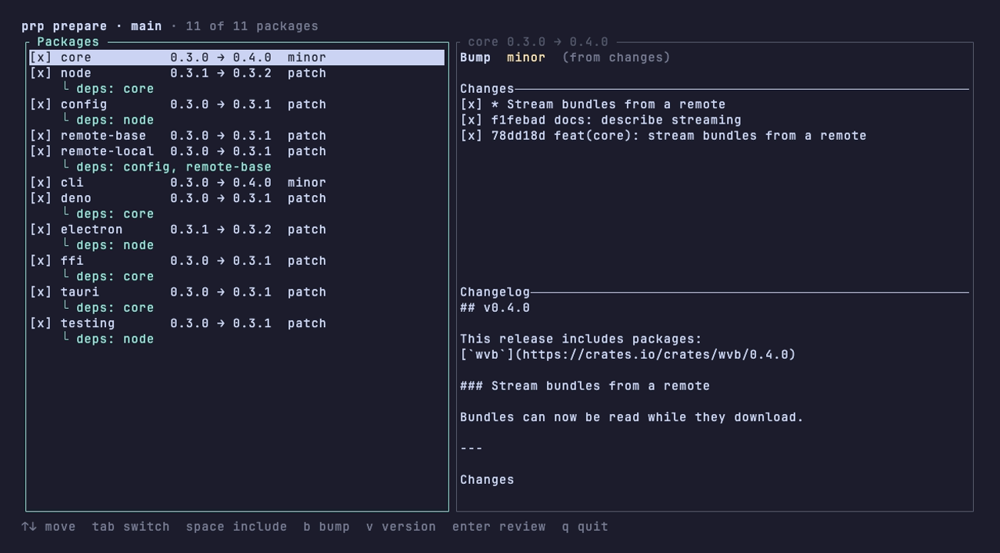

# prp

`prp` (please release please) manages versions, changelogs and publishing for monorepos with npm packages, Cargo crates and Deno (JSR) packages.



## Why?

`prp` was built to make publishing many packages, written in more than one language, less painful.

**1. Versioning**

Once packages start depending on each other, managing their versions by hand gets hard quickly. `prp` reads the dependency graph between packages and decides how far each one has to be bumped.

For example, packages can be grouped in two ways.

`fixed` packages are always released together, with one version: the highest version in the group, bumped.

```toml
[packages]
fixed = [["packages/a", "packages/b"]]
```

With `a` at 1.0.0 and `b` at 1.2.0, a minor bump of `a` releases both at 1.3.0.

`linked` packages keep their own versions, but share the highest bump when they are released together. A package without changes is not released.

```toml
[packages]
linked = [["packages/a", "packages/b", "packages/c"]]
```

With `a` at 1.0.0, `b` at 2.0.0 and `c` at 3.0.0, a minor bump of `a` and a patch bump of `b` become a minor bump of both: `a` is released at 1.1.0 and `b` at 2.1.0. `c` has no changes and stays at 3.0.0.

The concepts and names of `fixed` and `linked` are borrowed from [sampo](https://github.com/bruits/sampo/blob/main/crates/sampo/README.md#packages-section).

A fix for an older major version, such as a security patch, may need to be backported. With a release branch configured, `prp` bumps from the versions on that branch and opens the release pull request against it. Publish such a release with `prp release --dist-tag <tag>` so that npm's `latest` stays on the newest line.

**2. Changes**

Keeping track of changes in a busy monorepo is not easy, and one change can affect several packages, which takes a lot of effort to write down for each of them.

`prp` finds the changes of each package since its previous version from git tags. They are written from commit messages by default. For more context, write a detailed note with `prp change`.

## Installation

Install PRP using Cargo:

```sh
cargo install please-release-please

Or from npm:

```sh
npm install -D please-release-please
yarn add -D please-release-please
pnpm add -D please-release-please
```

## Getting Started

Initialize PRP in your repository:

```sh
prp init
```

This command creates a config file at `.prp/config.toml`, with the packages found in `package.json` workspaces, `pnpm-workspace.yaml`, the Cargo workspace or the Deno workspace:

```
.prp/
└─ config.toml
```

A release then goes like this:

```sh
prp change    # optional: write a note for the changelog
prp prepare   # choose the versions and open a release pull request
prp release   # after the merge: publish, tag and create GitHub releases
```

## Configuration

```toml
# The workspace root, relative to the working directory.
# Default: the working directory
root = "."

[git]
# The branch release pull requests target.
# Default: "main"
default_branch = "main"
# Other branches allowed to release, as globs. Empty allows every branch.
# Default: []
release_branches = ["release/*"]
# The tag of a released version. Placeholders: {package_name}, {version}.
# Default: "{package_name}-v{version}"
release_tag_format = "{package_name}@{version}"

[github]
# The GitHub API, to use GitHub Enterprise Server.
# Default: "https://api.github.com"
api_url = "https://api.github.com"
# The owner of the repository.
# Default: taken from the `origin` remote
owner = "acme"
# The name of the repository.
# Default: taken from the `origin` remote
repo = "monorepo"
# Release without creating GitHub releases.
# Default: false
skip_releases = false
# The branch of a release pull request. Placeholders: {branch}, {commit}.
# Default: "prp/{branch}_{commit}"
release_pr_branch_format = "release/{branch}"
# The title of a release pull request and its commit. Placeholders: {num}.
# Commits starting with its text before the first placeholder count as release commits.
# Default: "release: {num}(s) packages"
release_pr_title_format = "release: {num} packages"
# Labels added to a release pull request.
# Default: []
release_pr_labels = ["release"]

[changelog]
# Also write every release to the root changelog.
# Default: true
root = true
# The root changelog, relative to the workspace root.
# Default: "CHANGELOG.md"
root_filename = "CHANGELOG.md"
# The changelog of a package, relative to its directory.
# Default: "CHANGELOG.md"
filename = "CHANGELOG.md"
# How a commit is listed. Placeholders: {summary}, {body}, {sha}, {author_name},
# {author_email}, {committer_name}, {committer_email}.
# Default: ["- {summary} by {author_name} ({sha})"]
commit_templates = ["- {summary} ({sha})"]
# Put before the title of a breaking change file.
# Default: "**[BREAKING]** "
breaking_prefix = "**[BREAKING]** "
# List the commits of a release.
# Default: true
show_commits = true
# Link the registry pages of the published packages.
# Default: true
show_registries = true

[packages]
# Directories of the packages, as globs. Empty finds every versioned manifest.
# Required
includes = ["packages/*", "crates/*"]
# Directories to leave out, as globs.
# Default: []
excludes = ["packages/internal/*"]
# Packages always released together, with one version.
# Default: []
fixed = [["packages/core", "packages/cli"]]
# Packages sharing the highest bump when released together.
# Default: []
linked = [["packages/react", "packages/vue"]]
# Files whose changes alone do not release a package.
# Default: ["**/*.md"]
changes_ignore = ["**/*.md", "**/tests/**"]

# Settings of one package, by its directory.
[packages."packages/node"]
# The name used in tags, changelogs and output.
# Default: the directory, or "root" for the workspace root
name = "node"
# Replaces git.release_tag_format for this package.
# Default: git.release_tag_format
release_tag_format = "node/{version}"
# Manifests of the package, as globs relative to its directory.
# Default: the manifests directly in the directory
manifests = ["package.json", "npm/*/package.json"]
# Commands run in the package directory before it is published.
# Default: []
before_publish_scripts = [{ command = "yarn", args = ["build"] }]
# Files uploaded to the GitHub release, as globs relative to the package directory.
# Default: []
assets = ["artifacts/*.node"]
# Replaces packages.changes_ignore for this package.
# Default: packages.changes_ignore
changes_ignore = ["**/*.md"]
# Release the package without a GitHub release.
# Default: false
skip_github_release = false
# Bump the versions but do not publish to a registry.
# Default: false
skip_publish = false

[http]
# The User-Agent of HTTP requests.
# Default: "prp/<version>"
user_agent = "prp"
# Seconds before an HTTP request gives up.
# Default: no timeout
timeout_secs = 30

[registry.npm]
# The registry versions are looked up in.
# Default: "https://registry.npmjs.org"
registry = "https://registry.npmjs.org"
# The registry packages are published to.
# Default: the package manager's own setting
publish_registry = "https://npm.pkg.github.com"
# The command publishing a package, run in its directory.
# Default: the command of the package manager in use, such as "npm publish"
publish_command = "yarn npm publish --access=public --provenance"

[registry.cargo]
# The sparse index crate versions are looked up in.
# Default: "https://index.crates.io"
index = "https://index.crates.io"

[registry.jsr]
# The JSR API versions are looked up in.
# Default: "https://api.jsr.io"
api_url = "https://api.jsr.io"
# The command publishing a package, run in its directory.
# Default: "deno publish --allow-dirty"
publish_command = "deno publish --allow-dirty --allow-slow-types"
```

## Commands

| Command       | Description                                                                       |
|---------------|-----------------------------------------------------------------------------------|
| `prp init`    | Create `.prp/config.toml`                                                         |
| `prp status`  | List packages, their groups and their latest published versions                   |
| `prp change`  | Write a change file for the current commit                                        |
| `prp prepare` | Choose versions, update manifests and changelogs, and open a release pull request |
| `prp release` | Publish packages, push tags and create GitHub releases                            |

`prp prepare` opens an editor to review the versions. Pass `--auto` to skip it, which is required outside a terminal.

### Exit codes

| Exit Code | Description                                             |
|-----------|---------------------------------------------------------|
| `0`       | Success                                                 |
| `1`       | Error                                                   |
| `2`       | No changes - command succeeded but no action was needed |

## License

MIT License
